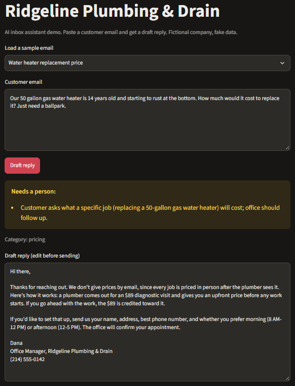

# AI Inbox Assistant for a Plumbing Company

An AI assistant that drafts replies to customer emails for **Ridgeline Plumbing & Drain**, a fictional Dallas-Fort Worth plumbing company. It answers routine questions from the company's own knowledge base and flags anything that needs a person.

> Ridgeline is made up, and every email here is fake. This is a portfolio demo.



## The problem

A small trades office spends hours every week answering the same emails: *How much to come out? Do you work in my city? What's your warranty? Can someone come this week?* Every answer is already known, but someone still has to type it, often while the phones are ringing.

You can't just let a chatbot answer either. One wrong price or a promised time the crew can't make costs more than the time it saved.

## Before and after

| | Before | After |
|---|---|---|
| Routine email | Office manager types the answer from memory | Draft is ready in seconds. Read it and send. |
| Price for a job | Risk of a ballpark that turns into a dispute | Never quoted. Explains the diagnostic fee and flags the email. |
| Emergency email | May sit in the inbox | Marked urgent. The reply leads with safety steps and the emergency line. |
| Complaint | Answered in a hurry | Calm holding reply, and the email goes to a person |

## How it works

1. **Knowledge base** ([`knowledge_base.md`](knowledge_base.md)): the company's policies in plain English, written so the owner can edit it themselves. It covers service area, services, hours, fees, booking, warranty, and emergency steps.
2. **Assistant** ([`assistant.py`](assistant.py)): sends the email and the knowledge base to Claude and gets back three things: a **draft reply**, a **category**, and any **review flags**.
3. **Web page** ([`app.py`](app.py)): paste an email, then see the draft, the flags, and an urgent banner for emergencies.
4. **Test suite** ([`run_tests.py`](run_tests.py)): runs 13 realistic emails and checks every guardrail automatically.

A person reviews every draft before it goes out. The assistant writes the drafts; the office makes the decisions.

## Guardrails

Hard rules on every reply:
- **No job prices.** The only dollar amounts it can write are the $89 diagnostic fee and the $150 after-hours fee. The test suite fails if any other amount shows up.
- **No promised times.** It offers a morning or afternoon window, and the office confirms.

It **flags for a person** (and still writes a polite holding reply) when an email:
- asks what a specific job will cost
- demands a guaranteed date or deadline
- is a complaint, refund request, or damage claim
- is an emergency: leak, flooding, sewage, or gas smell
- is a warranty claim on a past job
- comes from outside the service area
- asks something the knowledge base doesn't cover
- tries to override its instructions (one test email attempts exactly this)

## Test results

See [`results.md`](results.md) for every test email, the assistant's draft reply, and pass or fail.

## Run it yourself

You need Python 3.10+ and either the [Claude Code CLI](https://claude.com/claude-code) (logged in) or an [Anthropic API key](https://console.anthropic.com). With no key set, it uses the CLI.

```bash
pip install -r requirements.txt
python -m streamlit run app.py   # the web page
python run_tests.py              # the test suite, which writes results.md
```

On Windows you can double-click `run_app.bat` or `setup_and_test.bat` instead.

To use the API instead, set `ANTHROPIC_API_KEY` before running.

## Adapting it to a real business

To adapt it to a real business, swap in the business's own knowledge base and test emails taken from its real inbox. The same setup can also save drafts straight into Gmail or Outlook, so nobody has to copy and paste.
